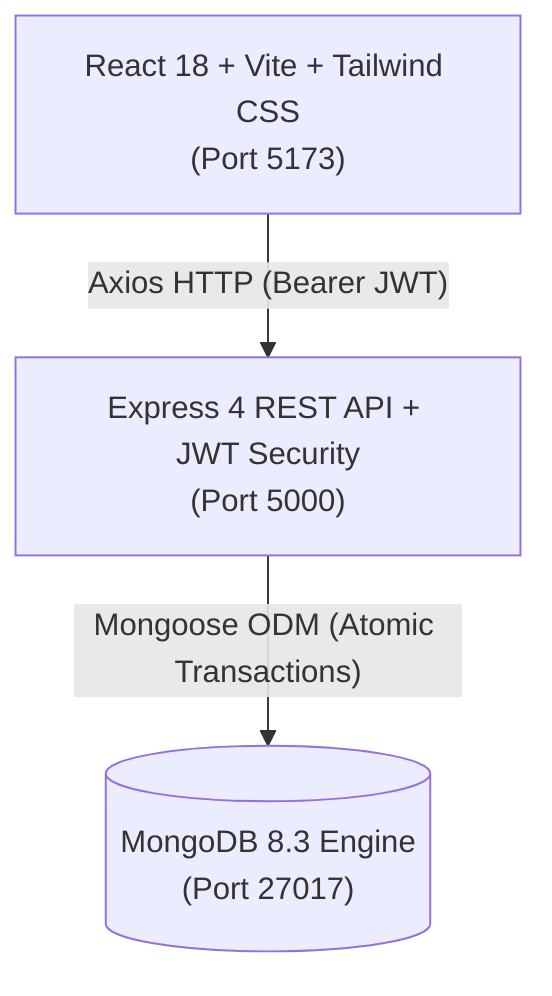

# VISTEON Inventory Management SaaS

A production-grade, enterprise inventory and component traceability web application built specifically for **VISTEON Corporation**.

Developed using the **MERN** stack (MongoDB, Express.js, React.js, Node.js), Vite, Tailwind CSS, and Lucide Icons with Visteon's brand identity.

---

## 1. System Architecture



### Brand & Design System
- **Primary Orange:** `#F58220` (Buttons, active navigation, key telemetry accents)
- **Charcoal Sidebar & Header:** `#20252B`
- **Main Canvas:** `#F3F4F6`
- **Card Background:** `#FFFFFF` with subtle `#E5E7EB` borders
- **Typography:** Inter geometric sans-serif

---

## 2. Key Modules & Workflows

### A. Dashboard Overview
- **4 Live KPI Cards (Calculated directly from MongoDB):**
  1. **Inventory Records:** Total count of active registered component records.
  2. **Unique Part Numbers:** Distinct part numbers currently represented in active stock (`qty > 0`).
  3. **Total Quantity:** Sum of all currently available component quantities.
  4. **Storage Location in Boxes:** Count of distinct occupied storage boxes containing available stock.
- **Inward vs Outward Movement Chart:** 7-day daily trend visualization powered by Recharts.
- **Stock by Automotive Program:** Real-time distribution progress bars.
- **Low Stock Attention Feed:** Highlights items with inventory below the configured threshold (&le; 10 units).
- **Recent Inward & Outward Telemetry:** Immediate visibility of plant movements.

### B. Inward Management & Component Registration
- **Create Part:** Form modal validating:
  - Part Number (e.g. `VP-IC-8200-RN`)
  - MPN - Material Part Number (e.g. `24810-7294R`)
  - Tracking ID - Unique individual barcode/lot identifier (e.g. `TRK-RN-9021`)
  - Automotive Program: Predefined dropdown (*Renault Nissan, Mahindra, Skoda, Tata, TVS, Royal Enfield, Honda, Maruti Suzuki, PSA*)
  - Quantity, Storage Box, Inward Date, Remarks
- **Receive Additional Stock:** Distinct workflow from part creation. Atomically increments inventory and records an immutable inward transaction.
- **No Silent Edits Rule:** Direct tampering of quantities via metadata editing is strictly prevented on the server.
- **Filter & Search:** Live search, Program filter, Box filter, Stock Status filter, Sorting, and Pagination.

### C. Outward Dispatch Terminal
- **Barcode & Hardware Scanner Interface:**
  - Auto-focused scanner input field supporting USB/Bluetooth keyboard-emulating scanners (Enter key capture).
  - Real-time visual feedback states: *Scanner Ready, Scanning, Item Found, Not Found*.
  - Audio tone feedback for warehouse operators.
- **Manual Component Search Fallback:** Search by Part No, MPN, Tracking ID, or Program with real-time stock balance display.
- **Outward Dispatch Form:**
  - Strict validation preventing dispatch of more than available stock.
  - Recipient line/station logging (e.g., `Assembly Line 1`, `QA Testing Lab`).
  - Reference number (Work Order / Dispatch Memo).
  - Two-step confirmation dialog.
  - Server-side atomic stock deduction using `{ $gte: quantity }` filter condition to prevent race conditions or negative inventory.

### D. Outward Reports & Audit Ledger
- Complete immutable audit table of every outward dispatch with historical component snapshots.
- Search by Transaction ID, Part Number, MPN, Tracking ID, Reference No.
- Filter by Program, Recipient, and Custom Date Range.
- Live summary aggregates: *Matching Outward Dispatches*, *Total Quantity Issued*, and *Distinct Parts Dispatched*.
- Full Transaction Audit Modal displaying exact state at time of issue.
- **CSV Export:** One-click download of filtered reports with full audit metadata.

### E. Settings & System Telemetry
- Company branding & default warehouse configuration.
- Allowed automotive programs viewer.
- Low stock threshold configuration.
- User profile & password management.
- Live database diagnostics (Node version, active records, transaction counts).
- **Load Sample Seed Data:** 1-click button to populate sample automotive parts and transactions.

---

## 3. Technology Stack

| Layer | Technologies |
|---|---|
| **Frontend** | React 18, Vite 6, Tailwind CSS, Lucide React, Recharts, Axios, React Router 6 |
| **Backend** | Node.js (v24), Express.js 4, Mongoose 8, bcryptjs, jsonwebtoken, morgan, express-rate-limit |
| **Database** | MongoDB 8.3 Enterprise / Community |

---

## 4. Directory Structure

```text
VISTEON INVENTORY MANAGEMENT/
├── client/                     # Vite + React Frontend
│   ├── public/                 # Favicon & assets
│   ├── src/
│   │   ├── assets/             # Brand logos & icons
│   │   ├── components/
│   │   │   ├── common/         # AppLayout, Sidebar, TopHeader, StatCard, Modal, Badge, Toast
│   │   │   ├── dashboard/      # InwardOutwardChart
│   │   │   ├── inward/         # CreatePartModal, ReceiveStockModal, PartDetailsModal, EditPartModal
│   │   │   ├── outward/        # BarcodeScannerInput, ManualComponentSearch, OutwardModal
│   │   │   └── reports/        # TransactionDetailsModal
│   │   ├── context/            # AuthContext, NotificationContext
│   │   ├── pages/              # LoginPage, DashboardPage, InwardPage, OutwardPage, ReportsPage, SettingsPage
│   │   ├── services/           # Axios API services
│   │   ├── App.jsx             # Routes & protected route guards
│   │   ├── main.jsx
│   │   └── index.css
│   ├── vite.config.js
│   ├── tailwind.config.js
│   └── package.json
├── server/                     # Express.js Backend API
│   ├── data/db/                # Local MongoDB data directory
│   ├── src/
│   │   ├── config/             # MongoDB connection & constants
│   │   ├── controllers/        # Auth, Inventory, Stock, Dashboard, Reports, Settings
│   │   ├── middleware/         # JWT Auth, Error Handler, Zod Validator
│   │   ├── models/             # User, InventoryRecord, StockTransaction, Settings
│   │   ├── routes/             # API routes
│   │   ├── utils/              # Database Seeder & CSV export
│   │   └── server.js           # Server entry point
│   ├── .env                    # Environment variables
│   ├── .env.example
│   ├── test-e2e-suite.js       # Automated 12-point verification suite
│   └── package.json
├── package.json                # Root development scripts
└── README.md
```

---

## 5. Getting Started

### Prerequisites
- Node.js (v18 or higher)
- npm (v9 or higher)
- MongoDB (installed locally or remote MongoDB Atlas connection string)

### Environment Variables
Configure `server/.env`:
```env
PORT=5000
MONGODB_URI=mongodb://127.0.0.1:27017/visteon_inventory
JWT_SECRET=visteon_super_secure_jwt_secret_key_2026_enterprise_sso
JWT_EXPIRES_IN=7d
NODE_ENV=development
```

### Installation

1. Install backend dependencies:
   ```bash
   cd server
   npm install
   ```

2. Install frontend dependencies:
   ```bash
   cd ../client
   npm install
   ```

### Running the Application

1. **Start MongoDB:**
   ```bash
   & "C:\Program Files\MongoDB\Server\8.3\bin\mongod.exe" --dbpath "server/data/db" --port 27017 --bind_ip 127.0.0.1
   ```

2. **Seed Sample Data (Optional):**
   ```bash
   cd server
   npm run seed
   ```

3. **Start Backend Server:**
   ```bash
   cd server
   npm run dev
   # Runs on http://localhost:5000
   ```

4. **Start Frontend Client:**
   ```bash
   cd client
   npm run dev
   # Runs on http://localhost:5173
   ```

---

## 6. Default Demo Credentials

| Role | Email | Password | Access Level |
|---|---|---|---|
| **Operations Lead (Admin)** | `admin@visteon.com` | `admin123` | Full access, settings, user management |
| **Plant Operator** | `operator@visteon.com` | `operator123` | Inward receiving, outward dispatch, reports |

---

## 7. Automated Test Suite

A standalone 12-point automated end-to-end verification suite is included in `server/test-e2e-suite.js`:
```bash
node server/test-e2e-suite.js
```

**Verifies:**
1. Health check `/api/health`
2. Authentication & JWT token issuing
3. Live MongoDB calculations of all 4 KPI metrics
4. New part registration with initial inward snapshot
5. Strict duplicate Tracking ID enforcement
6. Atomic stock receipt (`Receive Stock`)
7. Prevention of silent quantity edits
8. Atomic stock outward dispatch with destination logging
9. Insufficient stock rejection
10. Outward reports query & aggregate calculations
11. CSV export generation with audit headers
12. System settings and database telemetry
